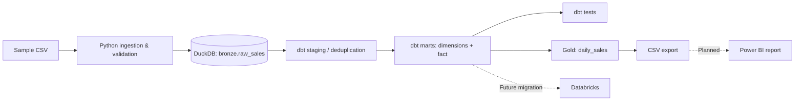

# End-to-End Sales Analytics Pipeline

> **Local pipeline verified · Portfolio work in progress** — a reproducible ELT project using Python, DuckDB, dbt Core, Conda (Miniforge) and Docker Compose. The local pipeline has been run successfully; Databricks integration and the Power BI dashboard are **planned, not implemented**.

## Project overview

Sales data often arrives as raw transaction records with repeated updates, mixed status values and fields unsuitable for reporting. This project demonstrates a local ELT workflow that validates sample order-line data, stores it in a Bronze table, deduplicates and models it with dbt, tests warehouse models, and exports a daily-sales summary suitable for a downstream BI tool.

The provided dataset is **synthetic demonstration data**, not client or employer information.

## Development roadmap — Olist migration

The existing 11-row synthetic pipeline is a **verified local baseline**, not the final dataset. **M1 is completed:** the nine CSVs in the [Brazilian E-Commerce Public Dataset by Olist](https://www.kaggle.com/datasets/olistbr/brazilian-ecommerce) were acquired and profiled locally, with the profiling code and evidence committed. **M2 Olist Bronze ingestion, Olist Silver/Gold modelling, Power BI and Databricks are not yet implemented.** The synthetic baseline remains available for regression checks.

| Milestone | Scope | Status | Indicative timing |
| --- | --- | --- | --- |
| M0 | Preserve the verified synthetic local pipeline | **Completed** (baseline) | 2026-10-25 |
| M1 | Acquire and profile Olist's nine source CSVs | **Completed (local evidence + merged PR #1)** | 2026-10-25–26 |
| M2 | Build Python ingestion and DuckDB Bronze tables | Planned | Week 2 |
| M3 | Implement dbt Silver staging and cleaning | Planned | Week 3 |
| M4 | Build Gold dimensional models and business metrics | Planned | Weeks 4–5 |
| M5 | Add data quality, reconciliation and end-to-end CI | Planned | Week 6 |
| M6 | Deliver Power BI dashboard and portfolio v1.0 | Planned | Weeks 7–8 |
| M7 | Integrate Olist marketing funnel data | Optional | Week 9 |
| M8 | Migrate and reconcile models in Databricks / Delta Lake | Planned extension | Weeks 10–11+ |
| M9 | Incremental processing and scalability benchmarks | Optional | Week 12+ |

*Timelines are estimates based on roughly 8–12 hours per week, not delivery commitments. M0–M6 define the first complete local Olist portfolio release; advanced extensions can be reprioritised.*

**[Read the complete M0–M9 milestone plan →](docs/portfolio-next-steps.md)** for tasks, deliverables, dependencies, acceptance criteria, and suggested commits.

### M1 — Olist source profiling (completed)

The nine original Olist CSVs are stored **locally**, excluded by both `.gitignore` and `.dockerignore`, and mounted into the container via Docker Compose. Run the committed read-only profiler from the repository root after acquiring the data:

```powershell
docker compose run --rm pipeline python scripts/profile_olist.py
```

The local run profiled nine source tables (including 99,441 orders, 99,224 review rows and 1,000,163 geolocation rows), wrote five Git-ignored profiling reports, and documented source keys, missing values and relationship exceptions. All nine sets of headers were compared against the committed data dictionary. After merging [PR #1](https://github.com/CandyCheng-git/end-to-end-sales-analytics-pipeline/pull/1), the synthetic Compose pipeline was re-run locally: 11 rows ingested, 5 dbt models built, all 17 dbt tests passed (`PASS=22 WARN=0 ERROR=0`), and `daily_sales.csv` was exported. GitHub Actions independently passed **Python unit tests only**, not the raw-Olist profiling or end-to-end dbt pipeline.

See [source profiling findings](docs/olist_profiling.md), [verified source dictionary](docs/olist_data_dictionary.md) and [executed commands](docs/olist-m1-execution-notes.md). These results are **M1 profiling evidence, not Olist warehouse ingestion**.

## Architecture



**Stack currently in the project:** Python 3.12 · DuckDB · SQL · dbt-duckdb · Conda · Docker Compose · pytest · GitHub Actions (unit-test workflow).

| Layer | Implementation | Purpose |
| --- | --- | --- |
| Input | `data/raw/sample_sales.csv` | Synthetic transaction lines, including an updated version of a record |
| Bronze | `scripts/ingest_sales.py` | Validate records and load `bronze.raw_sales` into DuckDB |
| Staging | `dbt/models/staging/stg_sales.sql` | Cast fields, remove outdated duplicates, calculate line amounts |
| Marts | `dbt/models/marts/` | `dim_customers`, `dim_products`, `fct_sales`, `daily_sales` |
| Quality | dbt generic tests + Python unit tests | Primary-key, null, value and relationship checks |
| Export | `scripts/export_gold.py` | Write `data/processed/daily_sales.csv` |

## Run locally with Conda

Install [Conda](https://docs.conda.io/) (or a compatible distribution), then run from the **repository root**:

```bash
conda env create -f environment.yml
conda activate sales-analytics
python scripts/ingest_sales.py
dbt debug --project-dir dbt --profiles-dir .
dbt build --project-dir dbt --profiles-dir .
python scripts/export_gold.py
python -m pytest -q
```

Expected warehouse file: `data/warehouse/sales.duckdb`.
Expected exported file: `data/processed/daily_sales.csv`.

For repeat runs, ingestion replaces the Bronze table from the local CSV, and `dbt build` refreshes the models; the output is **not yet an incremental or scheduled production pipeline**.

## Run with Docker Compose

Requires Docker Desktop or Docker Engine with Compose. From the repository root:

```bash
docker compose build
docker compose run --rm pipeline
```

The Compose command runs ingestion, dbt models/tests and CSV export in order. `data/` is mounted to persist generated warehouse and CSV artifacts on your host.

**Verified on Windows with Docker Desktop (2026-10-25):** the Docker image built successfully, and the full Compose command completed ingestion, dbt models/tests and CSV export. This is a local development validation, not a production deployment or a guarantee of identical results on every machine.

## Verified local execution (2026-10-25)

The following results were observed during a successful local run using `docker compose build`, `docker compose run --rm pipeline`, and `docker compose run --rm pipeline python -m pytest -q`:

| Check | Verified outcome |
| --- | --- |
| Environment | Docker image built; Python 3.12.15, dbt Core 1.12.6, dbt-duckdb 1.11.0 |
| Ingestion | 11 synthetic input rows loaded into `bronze.raw_sales` |
| dbt build | 5 SQL models built (1 view and 4 tables), 17 data tests passed |
| dbt summary | `PASS=22 WARN=0 ERROR=0 SKIP=0 NO-OP=0 REUSED=0 TOTAL=22` |
| Python unit tests | `11 passed` using pytest |
| Data export | `data/processed/daily_sales.csv` written and verified on the Windows host |
| Metrics validation | All four exported daily rows matched the expected sample metrics below |

The earlier dbt CLI argument error was corrected in `compose.yaml`. Generic test declarations were updated to use the `arguments` property, and the subsequent dbt run showed no deprecation warnings.

### Recheck the outputs (PowerShell)

From the repository root after the pipeline finishes:

```powershell
Test-Path .\data\warehouse\sales.duckdb
Test-Path .\data\processed\daily_sales.csv
Import-Csv .\data\processed\daily_sales.csv | Format-Table -AutoSize
```

The exported CSV is ready to **import** into Power BI Desktop; a Power BI report has **not** yet been built.

## Data model and business logic

- **Grain:** `fct_sales` contains one record per `(order_id, line_id)` after choosing the latest `source_updated_at` version.
- **Dimensions:** `dim_customers` and `dim_products` are illustrative current-state dimensions (not SCD Type 2).
- **Metrics:** `line_amount = quantity × unit_price`. Daily sales include `Completed` order lines only; cancelled and returned lines remain in the fact for investigation but do not count toward reported sales.
- **Scope:** Sample dates, amounts and customer/product attributes are synthetic. No taxes, discounts, shipping, currency conversions or refunds are modelled.

See [`docs/architecture.md`](docs/architecture.md) for technical decisions.

### Verified sample metrics

From the included synthetic CSV, after keeping the latest version of each order line and excluding `Cancelled` / `Returned` lines from daily totals, the **observed exported output (2026-10-25)** was:

| Date | Completed orders | Units sold | Gross sales |
| --- | ---: | ---: | ---: |
| 2026-09-01 | 2 | 6 | 190.30 |
| 2026-09-02 | 1 | 4 | 74.00 |
| 2026-09-03 | 2 | 4 | 147.80 |
| 2026-09-04 | 1 | 6 | 142.40 |

These four rows were checked against the exported CSV after the successful local dbt/DuckDB run. They describe synthetic data only, not real customer sales.

## Data quality

dbt models declare `not_null`, `unique`, `accepted_values` and `relationships` tests. Python ingestion rejects missing fields, invalid dates, invalid quantities/prices and unknown statuses before writing the Bronze table. **All 17 dbt data tests and all 11 Python unit tests passed locally** on 2026-10-25. The GitHub Actions workflow currently executes **Python unit tests only**; it does **not** run the complete ingestion → dbt → export integration pipeline.

## Current limitations

The verified downstream warehouse execution and metrics above relate **only to the synthetic local dataset**. Olist M1 source acquisition and profiling are completed; **Olist Bronze ingestion, Silver/Gold models and business KPIs have not been built**.

- No Olist ingestion, Silver/Gold Olist models or Olist business metrics have been verified yet.
- The Power BI report and Databricks integration are not yet implemented.
- GitHub Actions currently runs Python unit tests only; full-pipeline CI, scheduling, incremental loads and production monitoring remain future work.
- The sample model is a local proof of concept, not a production deployment.

See the [complete development roadmap](docs/portfolio-next-steps.md) for planned milestones and acceptance criteria.

## Repository guide

```text
.
├── .github/workflows/unit-tests.yml
├── data/raw/sample_sales.csv
├── dbt/models/{staging,marts}/
├── docs/{olist_profiling,olist_data_dictionary,olist-m1-execution-notes}.md
├── scripts/{ingest_sales,export_gold,profile_olist}.py
├── src/sales_analytics/validation.py
├── tests/test_validation.py
├── environment.yml
├── profiles.yml
├── Dockerfile
└── compose.yaml
```

## About this portfolio

This repository demonstrates an **executed and locally validated** Conda + Docker analytics workflow, including a documented reporting grain, transformations, quality checks and reproducible commands. It is **not** presented as production-ready, an automated full-pipeline CI build, or completed Databricks / Power BI work. Screenshots and cloud integration evidence will be added only after those features are actually implemented.
