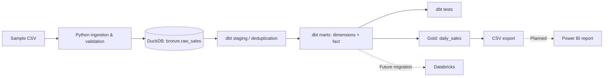

# End-to-End Sales Analytics Pipeline

> **M0–M3 implemented and verified · M4 Gold next** — Python + DuckDB + dbt Core + Docker Compose ELT portfolio. Nine Olist Bronze sources and 11 Silver models are implemented, with local full-data evidence and GitHub Actions fixture-based dbt CI. Olist Gold, Power BI and Databricks remain **planned, not implemented**.

## Project overview

Sales data often arrives as raw transaction records with repeated updates, mixed status values and fields unsuitable for reporting. This project demonstrates a local ELT workflow that validates sample order-line data, stores it in a Bronze table, deduplicates and models it with dbt, tests warehouse models, and exports a daily-sales summary suitable for a downstream BI tool.

The original 11-row baseline is **synthetic demonstration data**, not client or employer information. The Olist branch processes the public historical Brazilian E-Commerce dataset locally; its nine original CSVs and generated DuckDB warehouse are not committed to Git.

## Development roadmap — Olist migration

The existing 11-row synthetic pipeline remains a **verified regression baseline**. M1 profiled the nine CSVs in the [Brazilian E-Commerce Public Dataset by Olist](https://www.kaggle.com/datasets/olistbr/brazilian-ecommerce); M2 ingested them into DuckDB Bronze; **M3 added nine typed staging views, two intermediate models and dbt tests**. M3 [PR #4](https://github.com/CandyCheng-git/end-to-end-sales-analytics-pipeline/pull/4) was merged on 2026-11-11. Olist Gold marts, Power BI and Databricks are still unimplemented.

| Milestone | Scope | Status | Indicative timing |
| --- | --- | --- | --- |
| M0 | Preserve the verified synthetic local pipeline | **Completed** (baseline) | 2026-10-25 |
| M1 | Acquire and profile Olist's nine source CSVs | **Completed (local evidence + merged PR #1)** | 2026-10-25–26 |
| M2 | Build Python ingestion and DuckDB Bronze tables | **Completed — local verification evidenced** | 2026-11-04 |
| M3 | Implement dbt Silver staging and cleaning | **Completed — merged PR #4; local full-Olist + fixture CI verified** | 2026-11-11 |
| M4 | Build Gold dimensional models and business metrics | Planned | Weeks 4–5 |
| M5 | Expand Gold reconciliation, data quality and CI | **Planned — basic Python/dbt fixture CI already in M3** | Week 6 |
| M6 | Deliver Power BI dashboard and portfolio v1.0 | Planned | Weeks 7–8 |
| M7 | Integrate Olist marketing funnel data | Optional | Week 9 |
| M8 | Migrate and reconcile models in Databricks / Delta Lake | Planned extension | Weeks 10–11+ |
| M9 | Incremental processing and scalability benchmarks | Optional | Week 12+ |

*Timelines are estimates based on roughly 8–12 hours per week, not delivery commitments. M0–M6 define the first complete local Olist portfolio release; advanced extensions can be reprioritised.*

**[Milestone task tracker and M4 priorities](docs/portfolio-next-steps.md)** is the single source of truth for tasks, deliverables, dependencies, acceptance criteria and evidence. M3 execution evidence: [local M3 closeout](docs/olist-m3-execution-notes.md).

### M1 — Olist source profiling (completed)

The nine original Olist CSVs are stored **locally**, excluded by both `.gitignore` and `.dockerignore`, and mounted into the container via Docker Compose. Run the committed read-only profiler from the repository root after acquiring the data:

```powershell
docker compose run --rm pipeline python scripts/profile_olist.py
```

The local run profiled nine source tables (including 99,441 orders, 99,224 review rows and 1,000,163 geolocation rows), wrote five Git-ignored profiling reports, and documented source keys, missing values and relationship exceptions. All nine sets of headers were compared against the committed data dictionary. After merging [PR #1](https://github.com/CandyCheng-git/end-to-end-sales-analytics-pipeline/pull/1), the synthetic Compose pipeline was re-run locally: 11 rows ingested, 5 dbt models built, all 17 dbt tests passed (`PASS=22 WARN=0 ERROR=0`), and `daily_sales.csv` was exported. GitHub Actions independently passed **Python unit tests only**, not the raw-Olist profiling or end-to-end dbt pipeline.

See [source profiling findings](docs/olist_profiling.md), [verified source dictionary](docs/olist_data_dictionary.md) and [executed commands](docs/olist-m1-execution-notes.md). These results are **M1 profiling evidence, not Olist warehouse ingestion**.

## M2 — Olist Bronze ingestion (locally verified)

M2 adds a separate, deterministic **full-refresh** loader for all nine locally held Olist CSVs. This does not alter the default synthetic Compose pipeline. The loader validates the exact 52 source headers and every CSV row width before modifying DuckDB. It loads columns as `VARCHAR` (including leading-zero ZIP prefixes); casting, deduplication, geolocation aggregation and business decisions are intentionally deferred to dbt Silver.

Run from the repository root after acquiring the nine CSV files under the Git-ignored `data/raw/olist/` directory:

```powershell
docker compose build
docker compose run --rm olist-ingestion
docker compose run --rm pipeline python -m pytest -q
```

The loader creates `bronze.olist_orders`, `olist_order_items`, `olist_order_payments`, `olist_order_reviews`, `olist_customers`, `olist_products`, `olist_sellers`, `olist_geolocation`, and `olist_category_name_translation` in `data/warehouse/sales.duckdb`. It records a separate audit row for each source in `bronze.olist_ingestion_audit`: run ID, UTC timestamp, filename, target, SHA256, source size and reconciled source/warehouse counts.

All nine table replacements and audit inserts run in one DuckDB transaction. A failed run rolls back; a successful repeat run replaces source tables rather than accumulating duplicates, while retaining historical audit entries.

**Verified 2026-11-04 (user-supplied Windows / Docker output):** Both full-source runs loaded 9 Olist tables and 1,550,922 rows, with the same per-source row counts each time. The audit query returned two distinct run IDs, each with 9 source files and matching totals of 1,550,922 input and Bronze rows. The post-ingestion synthetic Compose run built 5 models and passed 17 dbt data tests (`PASS=22 WARN=0 ERROR=0`), exported `daily_sales.csv`, and local pytest passed 17 tests. See [M2 executed evidence](docs/olist-m2-execution-notes.md). GitHub Actions independently ran **fixture-based Python/DuckDB tests only**; it did not receive the Kaggle CSVs or execute the full dbt pipeline. Source SHA256 values were captured and rechecked during each run, but the shared transcript did not include a separate comparison of these hashes with the M1 report.

- `docs/olist-m2-execution-notes.md`: user-provided full-source row counts, two-run audit reconciliation, synthetic regression and test evidence.

## M3 — Olist Silver transformations (completed)

M3 creates **nine staging views** for orders, order items, payments, reviews, customers, products, sellers, geolocation, and Portuguese-to-English category translations. It also creates **two intermediate models**: `int_olist_geolocation_zip` (a ZIP-prefix table using median latitude/longitude to avoid join fanout) and `int_olist_products_enriched` (product categories plus explicit mapping status). Order-item, payment, and review grains remain separate; ZIP prefixes remain text to preserve leading zeros.

Run after you have locally ingested all nine Olist CSVs into Bronze. Disconnect GUI DuckDB clients before running dbt against the same warehouse:

```powershell
docker compose build pipeline
docker compose run --rm olist-ingestion
docker compose run --rm pipeline dbt build --project-dir dbt --profiles-dir . --select "stg_olist_*" "int_olist_*"
```

**Owner-reported full Olist run (2026-11-11):** `PASS=67 WARN=0 ERROR=0` (11 models + 56 dbt data tests), nine Bronze–Silver counts reconciled at **1,550,922 rows**, 19,015 distinct ZIP prefixes and 32,951 products retained. A reviewed order-item/ZIP join preserved **112,650 of 112,650** item keys without core-business join misses. Local synthetic regression separately passed `PASS=22 WARN=0 ERROR=0` and exported `daily_sales.csv`. See [M3 execution notes](docs/olist-m3-execution-notes.md) for scope, anomalies and provenance.

**GitHub CI:** [`.github/workflows/dbt-silver.yml`](.github/workflows/dbt-silver.yml) creates a **small synthetic nine-table Olist fixture** in an isolated `data/ci/sales.duckdb`, runs the same 11 Silver models + 56 tests, asserts ZIP/category/review/payment/join grains, then runs the 5-model + 17-test synthetic baseline and export. The separate Python workflow runs 17 pytest tests. **A green CI run does not mean GitHub processed the original full Olist CSVs.** Never run the fixture seed against the production/local real-data warehouse; the fixture seeder writes to `data/ci/` only.

**M4 next:** Define the Gold fact/dimension grains and a [metric contract](docs/portfolio-next-steps.md#m4--gold-star-schema-and-business-metrics) before writing revenue SQL. Olist item GMV, order-level payments and review rows cannot be safely summed in one raw one-to-many join.

## Architecture



**Stack currently in the project:** Python 3.12 · DuckDB · SQL · dbt-duckdb · Conda · Docker Compose · pytest · GitHub Actions (Python unit tests and fixture-based dbt Silver integration). The diagram above depicts the preserved synthetic baseline; M3 adds a separate Olist Bronze → Silver path.

| Layer | Implementation | Purpose |
| --- | --- | --- |
| Input | `data/raw/sample_sales.csv` | Synthetic transaction lines, including an updated version of a record |
| Bronze | `scripts/ingest_sales.py` | Validate records and load `bronze.raw_sales` into DuckDB |
| Staging | `dbt/models/staging/stg_sales.sql` | Cast fields, remove outdated duplicates, calculate line amounts |
| Marts | `dbt/models/marts/` | `dim_customers`, `dim_products`, `fct_sales`, `daily_sales` |
| Quality | dbt generic tests + Python unit tests | Primary-key, null, value and relationship checks |
| Export | `scripts/export_gold.py` | Write `data/processed/daily_sales.csv` |

## Run locally with Conda

Install [Conda](https://docs.conda.io/) (or a compatible distribution), then run from the **repository root**:

```bash
conda env create -f environment.yml
conda activate sales-analytics
python scripts/ingest_sales.py
dbt debug --project-dir dbt --profiles-dir .
dbt build --project-dir dbt --profiles-dir . --select stg_sales+
python scripts/export_gold.py
python -m pytest -q
```

Expected warehouse file: `data/warehouse/sales.duckdb`.
Expected exported file: `data/processed/daily_sales.csv`.

For repeat runs, ingestion replaces the Bronze table from the local CSV, and `dbt build` refreshes the models; the output is **not yet an incremental or scheduled production pipeline**.

## Run with Docker Compose

Requires Docker Desktop or Docker Engine with Compose. From the repository root:

```bash
docker compose build
docker compose run --rm pipeline
```

The default Compose `pipeline` command runs **only the original synthetic** ingestion, `dbt build --select stg_sales+`, and CSV export. This intentional selection avoids requiring local Olist Bronze tables for the baseline. `data/` is mounted to persist generated warehouse and CSV artifacts on your host; the Olist build uses the separate command in M3 above.

**Verified on Windows with Docker Desktop (2026-10-25):** the Docker image built successfully, and the full Compose command completed ingestion, dbt models/tests and CSV export. This is a local development validation, not a production deployment or a guarantee of identical results on every machine.

## Verified local execution (2026-10-25)

The following results were observed during a successful local run using `docker compose build`, `docker compose run --rm pipeline`, and `docker compose run --rm pipeline python -m pytest -q`:

| Check | Verified outcome |
| --- | --- |
| Environment | Docker image built; Python 3.12.15, dbt Core 1.12.6, dbt-duckdb 1.11.0 |
| Ingestion | 11 synthetic input rows loaded into `bronze.raw_sales` |
| dbt build | 5 SQL models built (1 view and 4 tables), 17 data tests passed |
| dbt summary | `PASS=22 WARN=0 ERROR=0 SKIP=0 NO-OP=0 REUSED=0 TOTAL=22` |
| Python unit tests | `11 passed` using pytest |
| Data export | `data/processed/daily_sales.csv` written and verified on the Windows host |
| Metrics validation | All four exported daily rows matched the expected sample metrics below |

The earlier dbt CLI argument error was corrected in `compose.yaml`. Generic test declarations were updated to use the `arguments` property, and the subsequent dbt run showed no deprecation warnings.

### Recheck the outputs (PowerShell)

From the repository root after the pipeline finishes:

```powershell
Test-Path .\data\warehouse\sales.duckdb
Test-Path .\data\processed\daily_sales.csv
Import-Csv .\data\processed\daily_sales.csv | Format-Table -AutoSize
```

The exported CSV is ready to **import** into Power BI Desktop; a Power BI report has **not** yet been built.

## Data model and business logic

- **Grain:** `fct_sales` contains one record per `(order_id, line_id)` after choosing the latest `source_updated_at` version.
- **Dimensions:** `dim_customers` and `dim_products` are illustrative current-state dimensions (not SCD Type 2).
- **Metrics:** `line_amount = quantity × unit_price`. Daily sales include `Completed` order lines only; cancelled and returned lines remain in the fact for investigation but do not count toward reported sales.
- **Scope:** Sample dates, amounts and customer/product attributes are synthetic. No taxes, discounts, shipping, currency conversions or refunds are modelled.

See [`docs/architecture.md`](docs/architecture.md) for technical decisions.

### Verified sample metrics

From the included synthetic CSV, after keeping the latest version of each order line and excluding `Cancelled` / `Returned` lines from daily totals, the **observed exported output (2026-10-25)** was:

| Date | Completed orders | Units sold | Gross sales |
| --- | ---: | ---: | ---: |
| 2026-09-01 | 2 | 6 | 190.30 |
| 2026-09-02 | 1 | 4 | 74.00 |
| 2026-09-03 | 2 | 4 | 147.80 |
| 2026-09-04 | 1 | 6 | 142.40 |

These four rows were checked against the exported CSV after the successful local dbt/DuckDB run. They describe synthetic data only, not real customer sales.

## Data quality

dbt models declare `not_null`, `unique`, `accepted_values` and `relationships` tests. The original synthetic loader validates its records; Olist Bronze uses separate audited full-refresh ingestion. **As of M3**, 56 Olist dbt data tests and 17 synthetic dbt data tests passed locally and on **synthetic-fixture GitHub CI**, while 17 pytest tests passed on GitHub CI. The full original Olist CSV data is validated locally only; GitHub CI does not access or reconcile those historical source files.

## Current limitations

- Olist M1 profiling, M2 Bronze and M3 Silver are implemented. **Olist Gold facts/dimensions, reconciled revenue KPIs and Power BI dashboards are not yet built**; the original synthetic Gold models do not represent final Olist KPIs.
- Full original Olist CSVs and DuckDB warehouse remain local/ignored. CI uses a **small synthetic Olist fixture**, not the full 1,550,922-row historical snapshot.
- M3 records exceptions, including category translation gaps, unmatched ZIP prefixes and delivery-date/status anomalies, without silently dropping records. These need explicit treatment in Gold business metric definitions.
- Scheduling, incremental loads, monitoring and Databricks / Delta Lake are not yet implemented.
- This is a documented portfolio system, not a production deployment.

See the [milestone task tracker](docs/portfolio-next-steps.md) for M4–M9 tasks and acceptance criteria.

## Repository guide

```text
.
├── .github/workflows/{unit-tests,dbt-silver}.yml
├── data/raw/sample_sales.csv       # committed synthetic baseline
├── data/raw/olist/                # local, ignored original Olist CSVs
├── data/ci/                       # ignored CI fixture warehouse
├── dbt/models/staging/{stg_sales.sql,olist/}
├── dbt/models/intermediate/olist/
├── dbt/models/marts/              # original synthetic baseline only
├── docs/portfolio-next-steps.md   # canonical task tracker
├── docs/olist-m{1,2,3}-execution-notes.md
├── scripts/{ingest_olist,ci_olist_fixtures,ingest_sales,export_gold}.py
├── tests/
├── environment.yml
├── profiles.yml
├── Dockerfile
└── compose.yaml
```

## About this portfolio

This repository demonstrates completed **Olist Bronze + Silver** transformations with local full-dataset reconciliation, fixture-based GitHub CI, explicit grain decisions and recorded anomalies. The original synthetic Gold demo is preserved. It is **not** production-ready, and Olist Gold KPIs, Power BI and Databricks remain future milestones.
