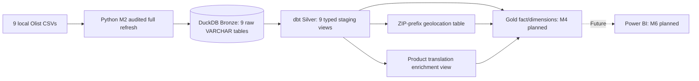

# Architecture and technical choices

## Local workflow

1. **Input:** versioned synthetic CSV order-line events in `data/raw/sample_sales.csv`.
2. **Validation:** reject rows with missing identifiers, invalid ISO dates, invalid quantity/price, or unsupported status.
3. **Bronze:** `bronze.raw_sales` stores validated raw text fields in DuckDB. Python ingestion replaces this table on each run, making demo runs deterministic.
4. **Staging:** `stg_sales` uses `row_number()` partitioned by `(order_id, line_id)` to keep the latest update, with typed dates/numbers and a deterministic sales-line key.
5. **Marts:** `fct_sales` preserves all statuses; customer and product dimensions describe reporting attributes; `daily_sales` aggregates only Completed lines.
6. **Quality:** dbt generic tests run during `dbt build`; independent unit tests check input validation.
7. **Export:** Power BI-ready CSV is generated from `analytics.daily_sales`.

## Assumptions and known gaps

- **Latest-version tie:** two updates to the same order line with identical timestamps would produce nondeterministic selection. A durable source event sequence is required in production.
- **Current-state dimensions:** max(customer_name) and max(product_name) produce sample lookup values, not history-aware SCDs. These fields are consistent in the example input.
- **Daily sales:** is sum of completed order-line prices before any taxes, discounts, refunds, exchange rates or shipping fees. It is not net revenue.
- **Data source:** fixed synthetic CSV (no live API ingestion). `requests` in the environment is reserved for future API ingestion.
- **Storage:** local DuckDB is a lightweight warehouse analogue; Databricks has not yet been integrated.
- **Execution:** manual/Compose only. No scheduling, retry or production orchestration is implemented.
- **Testing:** GitHub Actions runs Python unit tests and a fixture-based dbt integration build covering Olist Silver plus the synthetic baseline. It does not execute the owner's original historical Olist CSVs.

## Olist Bronze and Silver (M1–M3, completed)

The Olist data path is separate from the synthetic Gold example above:

Olist raw CSVs and the default warehouse in `data/warehouse/sales.duckdb` are kept local. The [M3 execution notes](olist-m3-execution-notes.md) record owner-supplied full-source reconciliation and exceptions; [PR #4](https://github.com/CandyCheng-git/end-to-end-sales-analytics-pipeline/pull/4) delivered the code, review and GitHub CI.

**Grain safeguards:** items use `(order_id, order_item_id)`; payments use `(order_id, payment_sequential)`; reviews use `(review_id, order_id)`; geolocation is aggregated to one representative row per ZIP prefix before joining; category enrichment retains every product with a mapping status. Gold must aggregate or keep separate one-to-many child tables rather than blindly joining and summing.

**CI data isolation:** `scripts/ci_olist_fixtures.py` seeds a **small fake Olist sample** under `data/ci/sales.duckdb`; GitHub Actions points dbt at that database via `DBT_DUCKDB_PATH`. This path is Git-ignored and is not the local full historical Olist warehouse. The synthetic sales regression still runs against its normal default warehouse.

## Why this is useful for a graduate data consultant

The project makes the transformation logic, schema grain, business-metric definitions, failure cases and model lineage inspectable without requiring cloud credentials. It is deliberately scoped to a working local proof of concept instead of overstating cloud/platform experience.
